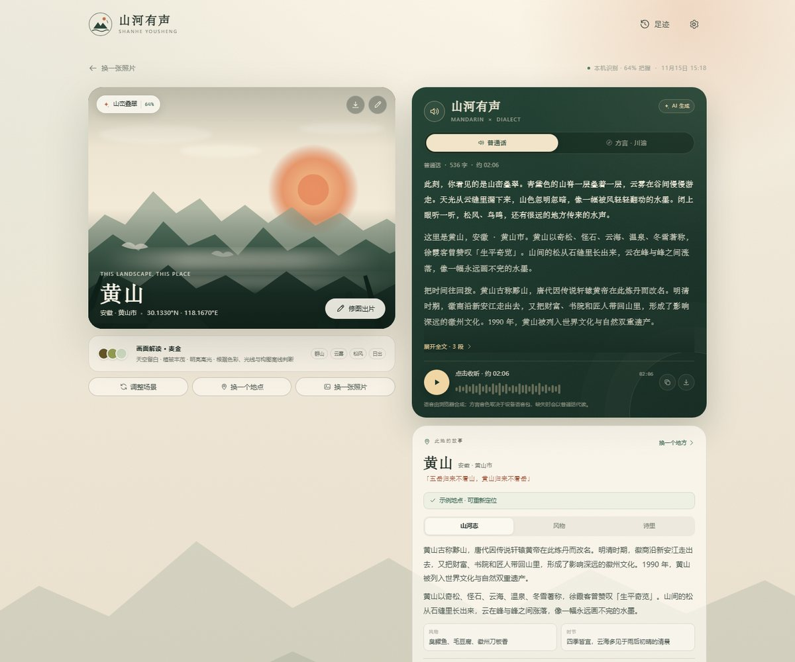

# 山河有声 · Shanhe Yousheng

> 让每一张风景，开口讲故事。

上传一张风景照片，应用会在本机完成画面理解，生成**普通话 + 方言双语音解**；读取手机定位（或手动选点）后，讲出此地的历史文化；还可以直接修图、做成一张本地绘制的水墨明信片、生成朋友圈文案，并把这段记忆收进本机足迹。

这是一个**可安装的移动优先 PWA**，零前端依赖：开发时无需构建即可运行，发布时一条命令生成纯静态 `dist/`，所有照片与故事都留在浏览器里。





> GitHub 上传、提交、分支与部署管理见 **[GITHUB.md](GITHUB.md)**。

---

## 快速开始

环境：Node.js 20+（仅用于静态文件服务；应用本身不需要后端）。

```bash
npm start
# 打开 http://localhost:4173
```

Windows 上也可以直接双击 `start.cmd`，它会自动寻找系统 Node 或当前 DSH 运行时里的 Node。

也可以使用任意静态服务器托管项目根目录：

```bash
python -m http.server 4173
```

---

## 部署到 HTTPS

生产包已经整理好：

```bash
npm run build       # 生成 dist/（纯静态、约 551 KB）
npm run check:dist  # 43 项上线前检查
npm run preview     # http://localhost:4174，带生产 CSP
```

可直接使用的产物：

- **`dist/`**：上传到 Netlify / Cloudflare Pages / Vercel 的站点根目录；
- **`shanhe-yousheng-https.zip`**：内容与 `dist/` 相同，可直接拖到 [Netlify Drop](https://app.netlify.com/drop)，几十秒获得 HTTPS 地址；
- **`Dockerfile` + `docker-compose.yml` + `deploy/Caddyfile`**：自有服务器 + Caddy 自动申请证书。

各平台的完整步骤、HTTPS 检查清单和更新方式见 **[DEPLOY.md](DEPLOY.md)**。当前构建只支持**域名根路径**；如果部署到 `https://example.com/app/` 这类二级目录，需要再做 base path 构建。

### 手机上体验定位

浏览器只在**安全上下文**中允许定位：

- 电脑本机访问 `http://localhost:4173` 可以使用定位；
- 手机通过局域网 `http://192.168.x.x:4173` 访问时，浏览器会拒绝定位。请把 `dist/` 部署到 HTTPS（例如 Vercel、Netlify、Cloudflare Pages 或任意带证书的静态空间），或使用浏览器的端口转发 / HTTPS 隧道；
- 无法定位时，应用提供**手动选点**，仍然可以完整走通地方志与双语音解流程。

---

## 已实现的功能

| 能力 | 说明 |
| --- | --- |
| 图片上传 | 相册、相机、拖拽三种入口；支持 JPG / PNG / WebP；超过 24MB 拒绝；上传前在本机压缩到 2400px |
| 风景识别 | 离线分析 20+ 项色彩、光线、纹理指标，识别 13 类风景：山峦、湖泊、海岸、日落、森林、草原、雪山、大漠、梯田、峡谷、古镇、城市、花海 |
| 识别可修正 | 「调整场景」允许用户覆盖分类；识别不是标准答案 |
| 双语音解 | 普通话 + 四川话 / 粤语 / 东北话 / 吴语 / 陕西话，5 种方言风格文本；自动优先推荐当地声腔 |
| 语音朗读 | 浏览器原生 SpeechSynthesis；分段朗读、进度反馈、停止；方言语音缺失时诚实降级为普通话 |
| 双语文稿 | 复制、导出 `.txt`；每篇包含画面、地点、历史、文化、诗句与收束 |
| 手机定位 | 浏览器 Geolocation；匹配最近的 53 个地方志地标之一，明确标注距离与方向，不把 400 公里外的地方硬说成「脚下」 |
| 地方志 | 53 个地标 / 城市，覆盖山河志、风物、诗里此地、吃什么、最佳时节；附高德地图跳转 |
| 手动选点 | 本地全文搜索，支持地名、省份、拼音别名；附近地标按距离排序 |
| 修图 | 6 款滤镜、亮度/对比度/饱和度/暖色/暗角、5 种裁剪比例、90° 旋转、题字水印；Canvas 导出高分辨率 JPEG |
| 水墨明信片 | 上传照片后从场景、配色与构图提炼下半版水墨，2:3 竖版双联；英文标题与短句可编辑、可换文案/换构图/调墨色，导出 2160×3240 PNG，不依赖外部生图服务 |
| 朋友圈文案 | 文艺、松弛、古风、攻略 4 种语气；可编辑、换一换、复制全文与话题标签 |
| 足迹 | 本机保存最多 6 段记忆（压缩图 + 地点 + 场景 + 文案参数），可重新打开、删除、清空 |
| PWA | manifest、Service Worker、离线缓存、安装到桌面、应用图标、深浅色主题变量 |
| 隐私 | 照片不上传；没有外部字体、CDN、分析脚本或第三方接口 |

---

## 体验路径

1. 首页拖入照片，或直接点选「黄山云海」等 5 个示例；
2. 等待约 2 秒的「读取光影 → 辨认山川 → 翻阅方志 → 润色音声」；
3. 在结果页：
   - 点「方言 · 吴语」切换语言，或选择其他声腔；
   - 点播放按钮听解说，点复制/下载保存文稿；
   - 在「此地的故事」里切换山河志 / 风物 / 诗里；
   - 点「开启定位」匹配附近地标，或点「换一个地方」手动搜索；
   - 点「修图出片」编辑、保存；
   - 点「水墨明信片」生成 2:3 双联明信片，改英文题字并保存 4K PNG；
   - 在「一键朋友圈」换风格、改字、复制；
   - 点「收进我的足迹」保存这一刻。
4. 从右上角「足迹」重新打开，或从「设置」调整默认方言、语速、自动定位与题字。

---

## 设计与实现

### 1. 离线风景识别

`src/logic/recognizer.js` 是纯函数：

- 计算天空、植被、水体、暖色、沙色、白色高光、灰度、彩色度、边缘密度等指标；
- 以场景特征加权分类，输出置信度与 Top 4 候选；
- 文件名只作为提示：正常照片中轻微加权；低信息量图片（低饱和、低纹理）中作为决定性提示；
- 全流程在 Canvas 上采样约 2 万像素，中低端手机也能在毫秒级完成。

### 2. 解说生成

`src/logic/narration.js` 把「画面语言 + 地方志 + 方言语气」拼成 6 段式解说。地方志数据全部为本地结构化的静态内容（`src/data/places-*.js`），不向外部模型请求，因此：

- 没有网络也能用；
- 不会把照片、位置或文案发送出去；
- 历史事实只来自已整理的数据，不现场编造年代与人物；
- 方言是**风格化再创作**，并非严格的语言学转写；正式使用建议请当地母语者审校。

如果接入视觉大模型或语音合成服务，可替换 `analyzeCurrent()` 与 `SpeechPlayer`，其余 UI 与数据层不需要改。

### 3. 定位策略

`resolvePlaceAt()` 将坐标与 53 个地标做球面距离匹配：

- ≤ 25 km：视为「就在此地」；
- 25–400 km：匹配最近地标，明确显示「距你约 N 公里，方向偏 X」；
- > 400 km：不冒充具体地点，生成诚实的坐标叙事，并给出最近地标作为参考。

所有匹配都显示来源：GPS、手动、示例、足迹或坐标叙事。

### 4. 修图

`src/ui/editor.js` 使用 Canvas 2D：

- 以原图最大 2400px 渲染，先按比例裁剪，再叠加滤镜与调色；
- 冷暖叠色使用 `soft-light`，暗角使用径向渐变，胶片颗粒使用可复用纹理；
- 题字使用宋体 + 金色短线，导出时保留；
- 保存为 JPEG，自动下载；若浏览器支持文件分享，可扩展为系统分享。

### 5. PWA / 隐私

- `sw.js` 缓存应用壳与示例图，离线可用；
- Service Worker 只处理同源 GET，不碰 `/api/`；
- 照片、解说、历史都在本机 `localStorage` / 内存中，没有后端数据库；
- 清空足迹即删除本机保存的压缩图与元数据。

---

## 目录

```text
.
├─ index.html                  # 应用壳与图标 sprite
├─ manifest.webmanifest        # PWA 清单
├─ sw.js                       # 离线缓存
├─ server.mjs                  # 零依赖静态服务器（支持 --root dist）
├─ config/security.mjs         # CSP / 安全头单一来源
├─ dist/                       # 生产构建产物（可直接部署）
├─ DEPLOY.md                   # Netlify / Vercel / Cloudflare / Caddy 部署指南
├─ netlify.toml                # Netlify 构建配置
├─ vercel.json                 # Vercel 构建 + 安全头
├─ wrangler.toml               # Cloudflare Pages 输出目录
├─ Dockerfile                  # Node 构建 + Caddy 运行
├─ docker-compose.yml          # 自有服务器 HTTPS 部署
├─ deploy/Caddyfile            # Caddy 自动 HTTPS 配置
├─ src/
│  ├─ app.js                   # 状态、渲染、交互、定位、足迹
│  ├─ styles.css               # 纸张 / 墨绿 / 朱砂视觉系统，响应式
│  ├─ data/
│  │  ├─ scenes.js             # 13 类风景语义
│  │  ├─ dialects.js           # 5 种方言声腔与文本模板
│  │  ├─ places-core.js        # 24 个核心地方志
│  │  ├─ places-more.js        # 29 个扩展地方志
│  │  ├─ postcard-copy.js      # 明信片英文题字库
│  │  └─ places.js             # 合并、搜索、索引
│  ├─ logic/
│  │  ├─ recognizer.js         # 像素分析 + 场景分类
│  │  ├─ narration.js          # 双语解说、时长、语音分段
│  │  ├─ copywriter.js         # 朋友圈文案
│  │  ├─ postcard.js          # 本地水墨明信片渲染器
│  │  ├─ geo.js                # 距离、方向、附近地标、诚实兜底
│  │  ├─ image.js              # 读取、缩放、导出、剪贴板
│  │  └─ speech.js             # SpeechSynthesis 封装
│  └─ ui/
│     ├─ editor.js             # Canvas 修图
│     └─ postcard.js           # 明信片工作室
├─ assets/                     # 5 张手绘 SVG 示例风景
├─ icons/                      # PWA 图标
├─ scripts/                    # 构建、产物校验、图标生成、CDP 验收脚本
└─ tests/                      # 纯函数测试
```

---

## 测试

```bash
npm test
```

当前 40 个单元测试覆盖：

- 场景分类与指标、文件名提示、异常图像；
- 球面距离、方位角、附近匹配与坐标兜底；
- 6 段式普通话/方言解说、时长、语音分段、文稿导出；
- 4 种文案语气、确定性、实用字段；
- 53 个地点的数据完整性与搜索；
- 明信片英文标题 / 短句的词数与大小写校验、场景文案、2:3 尺寸与墨色调色板。

生产构建校验：

```bash
npm run build
npm run check:dist
npm run preview
```

`check:dist` 会验证 43 项上线条件：必需文件、未泄漏开发文件、manifest、Service Worker 预缓存、CSP/HSTS、缓存策略与体积。

浏览器验收脚本（需要本机 Chrome 开启 `--remote-debugging-port=9222`）：

```bash
node scripts/browser-check.mjs
```

它会验证移动端无横向溢出、上传、定位、方言切换、选点、场景覆盖、文案、足迹、修图布局、设置、历史与 Service Worker，并输出截图到 `shots/`。生产 `dist/` 已在 CSP 头下跑通同一套流程。

---

## 已知边界

- 识别是**离线规则模型**，不是大规模视觉网络；对构图特殊、主体不明确的照片可能误判，因此提供「调整场景」。
- 地方志是精选的 53 个地标/城市，不是全国所有景点；不在附近时可用手动搜索或坐标叙事。
- 方言文本为风格化表达，语音是否地道取决于设备语音包；正式内容建议母语审校。
- 手机定位依赖 HTTPS；见上文「手机上体验定位」。
- 当前生产构建部署在**域名根路径**；项目子路径（如 GitHub Pages 的 `/repo/`）需要额外的 base path 构建。
- 图片与历史存于浏览器本地，清除浏览器数据会一并删除。

---

## 许可

项目内的示例插画、图标与文案为本次交付内容，可自由用于原型演示与二次开发。地方志中的诗句均标注作者或来源；部分民间概括已标注为「民间」。
